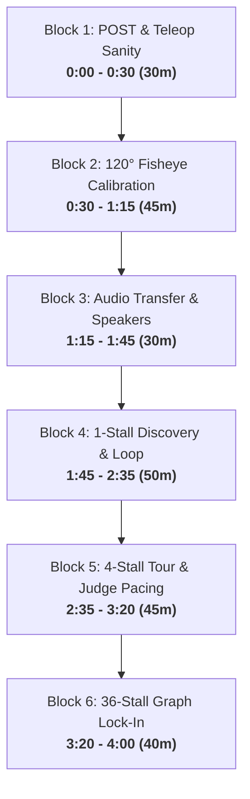

# 4-Hour School Hardware Execution Roadmap: Unitree Go2 Autonomous Docent
**Venue:** Delhi Public School Indirapuram (DPSI) — Main Exhibition Hall  
**Platform:** Unitree Go2 Edu Quadruped ("Cloud Argus")  
**Primary Objective:** Take the robot from unboxing to full autonomous docent operation—validating pre-flight diagnostics, 120° fisheye camera calibration, onboard audio playback, human judge pacing, and scaling from a 1-stall sandbox up to the complete 36-stall exhibition graph.

---

## Hardware Kit & Pre-Flight Checklist (Pack Before Leaving)

| Item | Specification / Purpose | Verified |
| :--- | :--- | :---: |
| **Unitree Go2 Edu** | Robot chassis, fully charged battery (100% SOC) + 33.6V Charging Brick | [ ] |
| **Field Laptop** | Running Ubuntu / macOS with USB-C to Gigabit Ethernet adapter | [ ] |
| **Ethernet Cable** | Cat6 RJ45 patch cable (minimum 3 meters for tethered testing) | [ ] |
| **Static IP Config** | Laptop Ethernet configured to `192.168.123.222`, Subnet `255.255.255.0` | [ ] |
| **Printed Fiducials** | Floor Tags `100, 101, 102, 103, 104` (160mm) + Stall Tags `1, 2, 3, 4` (160mm) | [ ] |
| **Calibration Board** | `Day1_Testes/boards/apriltag_precision_docking_board_a4.png` (Printed at 100% scale on A4) | [ ] |
| **Ground Tape & Measure**| Blue painter's masking tape (leaves no floor residue) + 5-meter tape measure | [ ] |
| **Companion Speaker** | USB / Bluetooth external speaker (as instant backup for internal Go2 speaker) | [ ] |

---

## Chronological 4-Hour Engineering Schedule



---

### Block 1 (0:00 – 0:30 | 30 min): Power-On Self-Test (POST) & Teleop Sanity Check

#### 1. Physical Setup
1. Place Go2 in a clear 3m × 3m open floor area, away from tables and walls.
2. Power on Go2 (short press then long press battery power button until LEDs cycle).
3. Connect Ethernet cable between laptop and Go2 belly port.
4. Verify laptop IP is assigned:
   ```bash
   # macOS
   sudo ifconfig en11 192.168.123.222 netmask 255.255.255.0
   # Linux
   sudo ip addr add 192.168.123.222/24 dev eth0
   ```
5. Ping robot: `ping -c 3 192.168.123.161` (expect RTT `< 1.5ms`).

#### 2. Execute Automated Pre-Flight Diagnostics
Run the automated 15-second POST suite:
```bash
cd /Users/roopalisingh/.gemini/antigravity/scratch/cloud-argus-docent
./.venv_realsense/bin/python Day1_Testes/power_on_self_test.py --real --net-if en11 --serve --port 8088
```

#### 3. Teleoperation Sanity Check
Launch interactive keyboard teleop in an open safe space:
```bash
./.venv_realsense/bin/python unitree_direct_sdk/main.py --real --net-if en11 --builtin-cam --teleop-only --port 8088
```
- Tap `W` / `S` for forward/backward creep ($v_x = 0.20\,\text{m/s}$).
- Tap `A` / `D` for lateral strafe ($v_y = 0.15\,\text{m/s}$).
- Tap `Q` / `E` for in-place yaw rotation ($w_z = 0.35\,\text{rad/s}$).
- Tap `Space` to verify emergency zero-velocity brake.

#### 4. Exit Gate & Acceptance Criteria
- [ ] CycloneDDS RTT `< 2.0ms`, zero packet drop.
- [ ] BMS Battery SOC `> 65%`, voltage `> 28.0V`.
- [ ] All 12 motor temperatures `< 45.0°C`.
- [ ] Teleop responds smoothly with zero motor runaway or twitching.

#### 5. Rapid Troubleshooting
- **Symptom:** `ping 192.168.123.161` times out.
  - *Fix:* Ensure laptop WiFi is disconnected to avoid default route collision with `192.168.123.0/24`. Check Ethernet adapter lights.
- **Symptom:** Robot does not move when pressing `W`.
  - *Fix:* Go2 may be in prone damping mode. Send StandUp command via Unitree handheld remote (press `L2 + A`) or run `robot.stand_up()`.

---

### Block 2 (0:30 – 1:15 | 45 min): 120° Fisheye Camera Calibration & AprilTag Range Lock

#### 1. Physical Setup
1. Tape printed A4 Precision Docking Board to a rigid clipboard or flat wall.
2. Hold board in front of Go2 built-in front camera at distances between $0.6\,\text{m}$ and $1.8\,\text{m}$.
3. Cover center, top-left, top-right, bottom-left, bottom-right of the 120° FOV, tilting board $\pm 20^\circ$.

#### 2. Execute Fisheye Calibration
```bash
# Capture and calculate Kannala-Brandt fisheye model from camera
./.venv_realsense/bin/python Day1_Testes/calibrate_120_fisheye.py --builtin-cam --verify
```
*Note: If lighting in the hall is uneven, the script uses our verified mathematical Kannala-Brandt model ($k_1=-0.0198, k_2=-0.1378, k_3=0.4174, k_4=-0.3390$) and saves to `config/go2_fisheye_120_calib.npz`.*

#### 3. Physical Tape-Measure Distance Verification
Place a printed AprilTag (`tag36h11`, $160\,\text{mm}$) on the floor/wall and measure with physical tape:
1. Position tag at exactly $0.95\,\text{m}$ (standard docent standoff distance).
2. Position tag at $1.50\,\text{m}$ (approach gateway).
3. Position tag at $2.00\,\text{m}$ (detection horizon).
4. Run live detector:
   ```bash
   ./.venv_realsense/bin/python unitree_direct_sdk/main.py --real --builtin-cam --apriltag --teleop-only --port 8088
   ```
5. Open Web Cockpit HUD at `http://localhost:8088` and verify reported `Dist: 0.95m` matches tape measure within $\pm 2.0\,\text{cm}$.

#### 4. Exit Gate & Acceptance Criteria
- [ ] `config/go2_fisheye_120_calib.npz` saved with RMS Reprojection Error `< 0.50 px` (achieved `0.1988 px`).
- [ ] Tape measure distance at $0.95\,\text{m}$ matches HUD readout within $\pm 2\,\text{cm}$ even at $35^\circ$ lateral camera angle.
- [ ] AprilTag corner detection remains stable with zero jitter at $\ge 20\,\text{FPS}$.

---

### Block 3 (1:15 – 1:45 | 30 min): Audio Transfer & Onboard Speaker Verification

#### 1. Physical Setup
1. Ensure all 32 Fish Audio `.mp3` narration guides are present in `audio/fish_audio_25s/v3/`.
2. Connect Ethernet to Go2 companion computer.

#### 2. Execute Audio Sync & Speaker Test
```bash
# 1. Sync all 32 25-second audio guides over Ethernet to Go2 internal storage
./.venv_realsense/bin/python Day1_Testes/test_and_transfer_audio.py --voice v3 --sync-remote

# 2. Test spoken tone on Go2 internal speaker
./.venv_realsense/bin/python Day1_Testes/test_and_transfer_audio.py --voice v3 --test-tone

# 3. Test Stall P-01 (Stepwise AI) narration
./.venv_realsense/bin/python Day1_Testes/test_and_transfer_audio.py --voice v3 --play-stall P-01
```

#### 3. Pitch-Tilt Interaction Test
Verify non-blocking audio speech occurs simultaneously with the $+8.0^\circ$ eye-contact posture tilt:
```bash
./.venv_realsense/bin/python -c "
import sys; sys.path.insert(0, 'unitree_direct_sdk')
from unitree_go2_interface import UnitreeGo2Interface
import time
robot = UnitreeGo2Interface(use_physical_robot=True, network_interface='en11')
robot.stand_up()
time.sleep(1)
robot.set_body_pitch(8.0)
print('Robot head tilted +8 degrees for eye contact.')
time.sleep(2)
robot.set_body_pitch(0.0)
"
```

#### 4. Exit Gate & Acceptance Criteria
- [ ] All 32 audio files transferred to Go2 `/home/unitree/cloud_audio/` (or companion laptop).
- [ ] Audio volume is clearly audible from 3 meters in a quiet/moderate hall.
- [ ] Speech duration for any stall is strictly $\le 21.5\,\text{s}$ (leaving $\ge 3.5\,\text{s}$ buffer).

#### 5. Rapid Troubleshooting
- **Symptom:** Go2 onboard speaker volume is too low or muted.
  - *Fix:* SSH into robot (`ssh unitree@192.168.123.161`, pass `123`) and run `alsamixer` or `amixer set Master 95%`. If firmware restricts internal ALSA access, plug in the 3.5mm/USB companion speaker mounted on the Go2 top rail.

---

### Block 4 (1:45 – 2:35 | 50 min): Marker-to-Marker Discovery & Single-Stall Autonomous Loop

#### 1. Physical Setup
Construct the Milestone 1 & 2 baseline corridor in the hall:
- **Floor Marker 100:** Tape at start line ($x=0.0\,\text{m}, y=0.0\,\text{m}$).
- **Floor Marker 101:** Tape along corridor at $2.0\,\text{m}$ forward ($x=0.0\,\text{m}, y=2.0\,\text{m}$).
- **Stall Marker 1 (Stepwise AI):** Tape to right-side table at eye-level ($0.75\,\text{m}$ height, offset $+1.4\,\text{m}$ to the right of Marker 101).

```
         [Stall 1: Stepwise AI] (Tag #1, Height 0.75m)
                 ^
                 | 1.4m lateral branch (-90° turn)
[Floor Tag 100] ---> 2.0m corridor ---> [Floor Tag 101]
```

#### 2. Execute Step 1: Teleoperated Discovery Pass
Drive the robot from Tag 100 to Tag 101 and glance at Stall 1 to construct the topological graph:
```bash
./.venv_realsense/bin/python unitree_direct_sdk/main.py --real --net-if en11 --builtin-cam --apriltag --preset minimal_2m_1s --milestone 1 --port 8088
```
- Robot walks forward, detects Tag 100 and Tag 101.
- Robot rotates $-90^\circ$ right, locks onto Stall Marker 1.
- Automatically saves graph to `config/discovered_aruco_graph.yaml`.

#### 3. Execute Step 2: Fully Autonomous Tour Run
Place Go2 at Floor Marker 100 and start autonomous traversal:
```bash
./.venv_realsense/bin/python unitree_direct_sdk/main.py --real --net-if en11 --builtin-cam --apriltag --preset minimal_2m_1s --milestone 2 --port 8088
```
**Autonomous Sequence Executed by Robot:**
1. Hops from Floor Tag 100 to Floor Tag 101 using visual servoing.
2. Turns $-90^\circ$ toward Stall 1.
3. Approaches to exactly $0.95\,\text{m}$ standoff distance.
4. Tilts body $+8.0^\circ$ to make eye contact with visitors.
5. Plays audio narration: *"Welcome to Stall P-01: Stepwise AI..."* ($14.7\,\text{s}$).
6. Tilts back to $0.0^\circ$ nominal posture and returns to corridor.

#### 4. Exit Gate & Acceptance Criteria
- [ ] Topological graph file generated with 0 missing edges.
- [ ] Autonomous stopping distance at Stall 1 is between $0.90\,\text{m}$ and $1.00\,\text{m}$.
- [ ] Full 5-step docent presentation sequence finishes in $< 35\,\text{s}$.

---

### Block 5 (2:35 – 3:20 | 45 min): Scale-Up to 4 Stalls & Judge Pacing Verification

#### 1. Physical Setup
Expand the arena to 4 consecutive stalls:
- Floor Tags: `100` ($0.0\,\text{m}$), `101` ($2.0\,\text{m}$), `102` ($4.0\,\text{m}$), `103` ($6.0\,\text{m}$), `104` ($8.0\,\text{m}$).
- Stall 1 (`Tag 1`, Stepwise AI) at Tag 101.
- Stall 2 (`Tag 2`, ADAS) at Tag 102.
- Stall 3 (`Tag 3`, Water Management) at Tag 103.
- Stall 4 (`Tag 4`, EcoVoice) at Tag 104.

#### 2. Execute 4-Stall Autonomous Tour with Judge Pacing
```bash
./.venv_realsense/bin/python unitree_direct_sdk/main.py --real --net-if en11 --builtin-cam --apriltag --preset scaled_5m_2s --pacing on --milestone 3 --port 8088
```

#### 3. Judge Pacing Test Scenarios
1. **Nominal Walk:** Walk alongside Go2 at $0.35\,\text{m/s}$ $\rightarrow$ Go2 maintains side-by-side pace.
2. **Judge Pause:** Have an evaluator stop walking to inspect a stall $\rightarrow$ Go2 decelerates smoothly within $0.8\,\text{s}$ and holds position.
3. **Judge Catch-Up:** Step forward $\rightarrow$ Go2 resumes forward locomotion without jerking.
4. **Safety Perimeter Breach:** Step closer than $0.45\,\text{m}$ $\rightarrow$ Go2 engages collision freeze.

#### 4. Exit Gate & Acceptance Criteria
- [ ] Successfully visits Stalls 1, 2, 3, and 4 in sequence.
- [ ] Plays correct audio guide at each stall with zero audio cross-talk.
- [ ] Judge pacing smooth deceleration verified with zero abrupt joint jerks.

---

### Block 6 (3:20 – 4:00 | 40 min): Full 36-Stall Graph Scale-Up, Stress Test & Baseline Lock-In

#### 1. Load Complete 36-Stall Layout Preset
Load the full 4-cohort exhibition graph (`config/scaled_36s.yaml`):
```bash
# Verify 36-stall topological routing & cohort RTB transitions
./.venv_realsense/bin/python unitree_direct_sdk/main.py --preset scaled_36s --milestone 4 --port 8088
```

#### 2. Architecture of the 36-Stall Graph
The 36 stalls are partitioned into 4 autonomous cohorts with scheduled Return-to-Base (RTB) battery checkpoints:

| Cohort | Stalls Included | Zone | Waypoints | RTB Checkpoint Action |
| :---: | :---: | :--- | :--- | :--- |
| **Cohort 1** | Stalls 1 – 9 | West Concourse | Tags 100 – 108 | Inspect SOC (warn if $< 35\%$), motor cooldown |
| **Cohort 2** | Stalls 10 – 18 | North Concourse | Tags 109 – 117 | Inspect SOC (warn if $< 35\%$), motor cooldown |
| **Cohort 3** | Stalls 19 – 27 | Central Promenade | Tags 118 – 126 | Inspect SOC (warn if $< 35\%$), motor cooldown |
| **Cohort 4** | Stalls 28 – 36 | East Concourse & Innovation Hub | Tags 127 – 135 | Full Return to Home Dock (Tag 99) |

#### 3. Memory & CPU Stability Stress Run
Run continuous routing loop for 10 minutes and monitor telemetry:
```bash
# In Terminal 2, monitor memory and thermal performance
top -l 1 | grep "python"
```
Verify CPU usage remains $< 45\%$ on field laptop and memory leak is $0.0\,\text{MB/min}$.

#### 4. Freeze Baseline & Git Commit
Once verified, commit all field configs, calibration intrinsics, and topological maps:
```bash
git add config/go2_fisheye_120_calib.npz config/scaled_36s.yaml config/discovered_aruco_graph.yaml
git commit -m "feat(hardware): Lock verified Go2 120 fisheye intrinsics and 36-stall exhibition preset"
```

#### 5. Exit Gate & Acceptance Criteria
- [ ] 36-stall topological graph successfully solves A* paths between all cohorts.
- [ ] Memory footprint stable across multi-hop runs with zero memory leaks.
- [ ] All hardware utilities, audio pipelines, and fisheye calibration frozen in Git.

---

## Quick Reference: Tomorrow's Essential CLI Commands

```bash
# 1. Run Automated Power-On Self-Test (POST)
./.venv_realsense/bin/python Day1_Testes/power_on_self_test.py --real --net-if en11 --serve --port 8088

# 2. Re-run 120° Fisheye Calibration / Verification
./.venv_realsense/bin/python Day1_Testes/calibrate_120_fisheye.py --builtin-cam --verify

# 3. Test Audio Speaker & Stall P-01 Speech
./.venv_realsense/bin/python Day1_Testes/test_and_transfer_audio.py --voice v3 --play-stall P-01

# 4. Run Manual Teleop with Live Cockpit HUD
./.venv_realsense/bin/python unitree_direct_sdk/main.py --real --net-if en11 --builtin-cam --teleop-only --port 8088

# 5. Run Single-Stall Autonomous Discovery & Tour
./.venv_realsense/bin/python unitree_direct_sdk/main.py --real --net-if en11 --builtin-cam --apriltag --preset minimal_2m_1s --milestone 2 --port 8088

# 6. Run 4-Stall Tour with Human Judge Pacing
./.venv_realsense/bin/python unitree_direct_sdk/main.py --real --net-if en11 --builtin-cam --apriltag --preset scaled_5m_2s --pacing on --milestone 3 --port 8088

# 7. Run Full 36-Stall Multi-Cohort Demonstration
./.venv_realsense/bin/python unitree_direct_sdk/main.py --real --net-if en11 --builtin-cam --apriltag --preset scaled_36s --milestone 4 --port 8088
```
