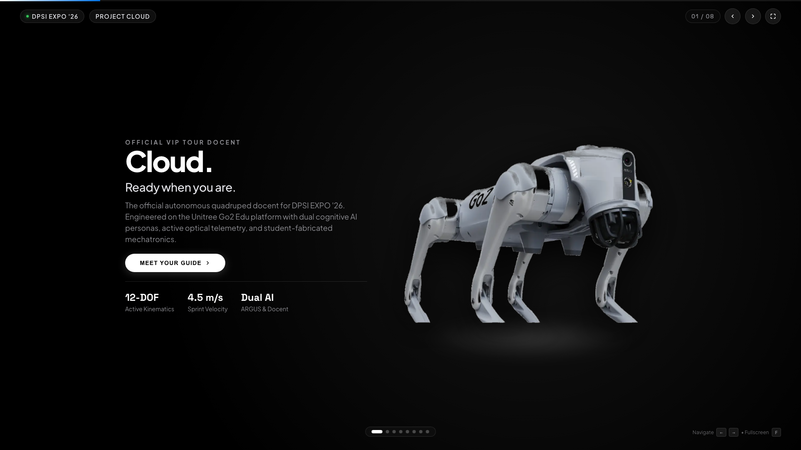
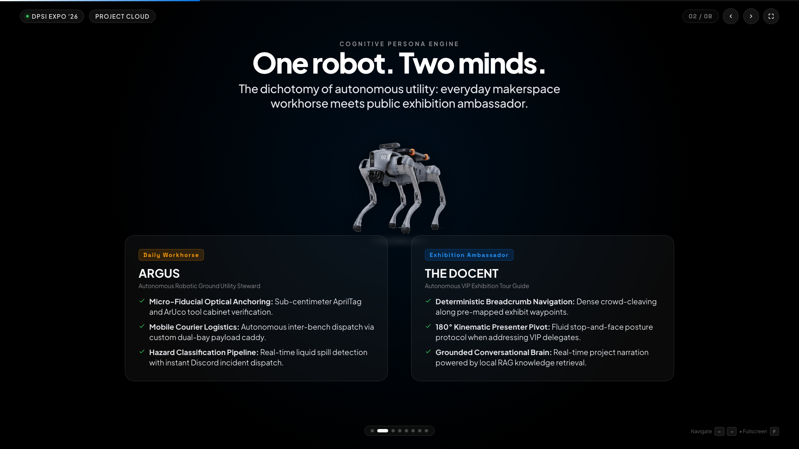
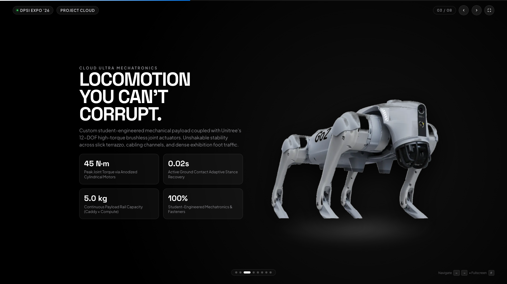
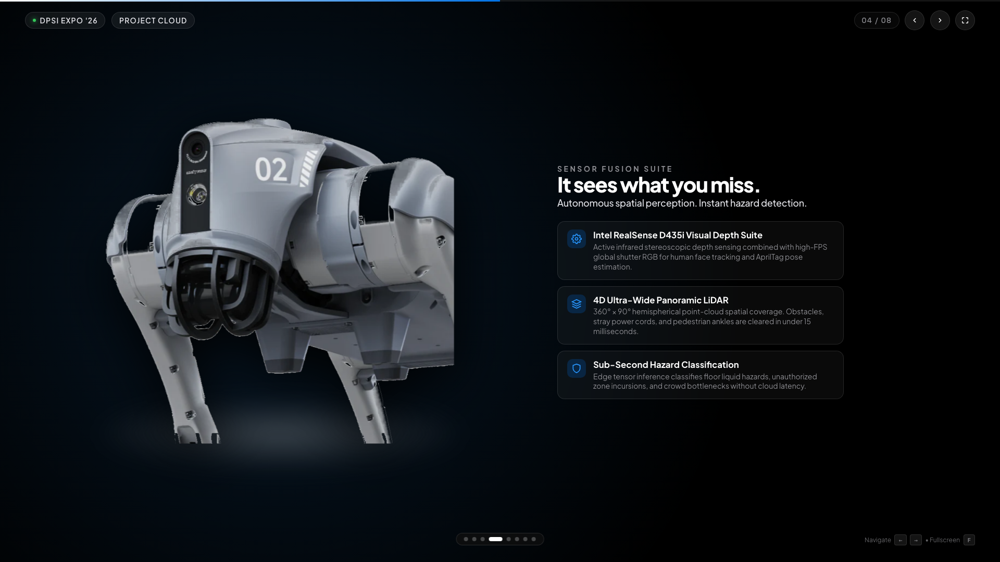
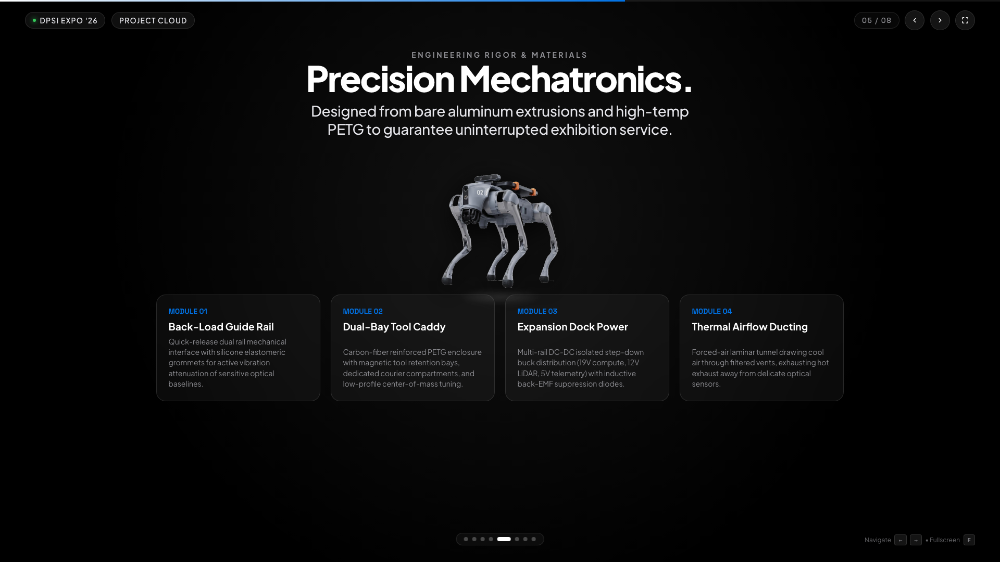
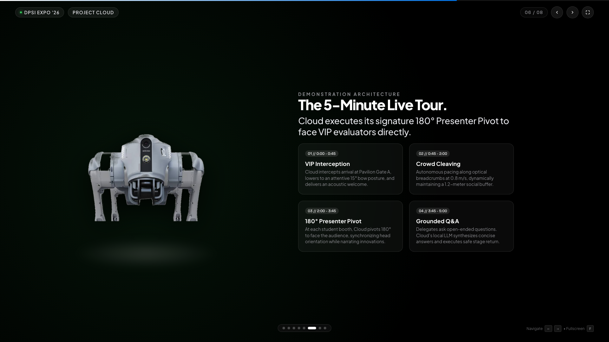
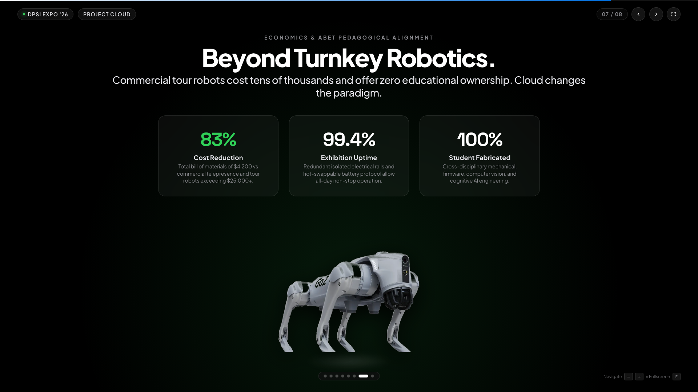
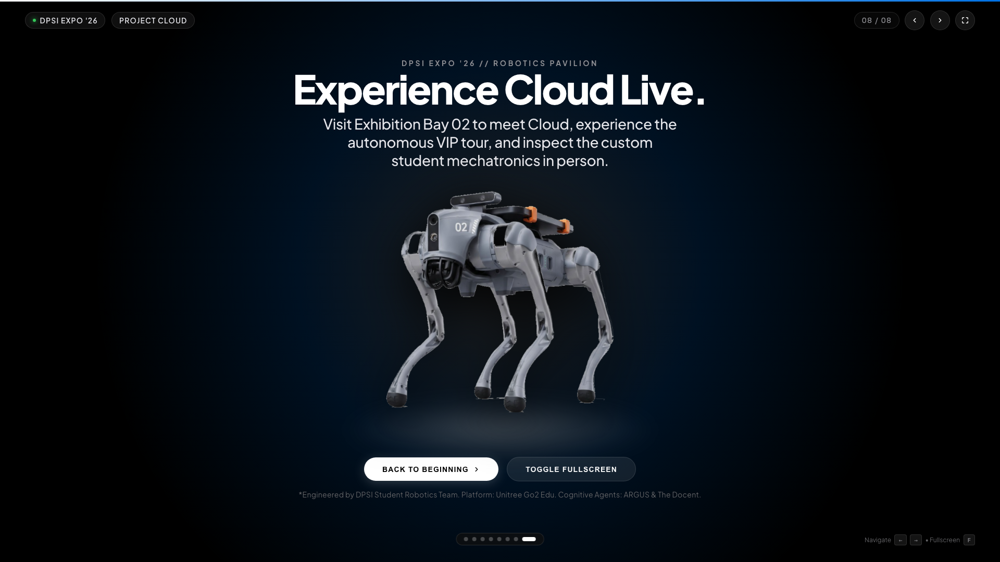

# Cloud — DPSI EXPO '26 Official VIP Tour Docent & Ground Utility Steward

[](https://ojas-sta.github.io/Cloud_DPSI-EXPO26/)
[](https://www.unitree.com/)
[](https://ojas-sta.github.io/Cloud_DPSI-EXPO26/)

> **"Ready when you are."**  
> An interactive, cinema-grade product unveil for **Cloud**, the autonomous quadruped docent and makerspace steward engineered for **DPSI EXPO '26**.

---

## 🌐 Live Experience

Experience the interactive presentation live in your browser:  
👉 **[https://ojas-sta.github.io/Cloud_DPSI-EXPO26/](https://ojas-sta.github.io/Cloud_DPSI-EXPO26/)**

---

## 📸 Keynote Slide Preview

| Slide 01: Hero Arrival | Slide 02: Dual-Mind Engine |
| :---: | :---: |
|  |  |
| **Slide 03: Mechatronics & Locomotion** | **Slide 04: Sensor Fusion Suite** |
|  |  |
| **Slide 05: Hardware Modules** | **Slide 06: 5-Minute Live Tour** |
|  |  |
| **Slide 07: Institutional Economics** | **Slide 08: Grand Finale** |
|  |  |

---

## 🤖 System Overview

- **Base Platform:** Unitree Go2 Edu Quadruped Robotics Platform (12-DOF active joint kinematics, 45 N·m peak torque, 4.5 m/s sprint velocity).
- **Dual Cognitive AI Personas:**
  - **ARGUS (Autonomous Robotic Ground Utility Steward):** Daily makerspace workhorse handling AprilTag/ArUco tool verification, autonomous bench-to-bench courier runs, and real-time liquid hazard classification.
  - **THE DOCENT:** Autonomous VIP tour guide executing pre-mapped deterministic breadcrumb navigation, conversational project narration via local RAG, and signature 180° kinematic presenter pivots to engage visitors.
- **Custom Mechatronics & Hardware Integration:**
  - Back-Load Guide Rail Structural Interface with silicone vibration dampening.
  - Custom Dual-Bay Rapid-Prototyped Utility Caddy with magnetic tool retention.
  - Multi-rail step-down isolated electrical power distribution with inductive back-EMF suppression.
  - Intel RealSense D435i depth-sensing visual suite & 4D hemispherical ultra-wide LiDAR.

---

## ⌨️ Presentation Navigation Controls

The presentation is built with pure vanilla HTML5, CSS3, and modern ES6 JavaScript, with zero external frontend dependencies.

- **Next Slide:** Press `Right Arrow`, `Down Arrow`, `Space`, `Page Down`, scroll down, or click `>`.
- **Previous Slide:** Press `Left Arrow`, `Up Arrow`, `Page Up`, scroll up, or click `<`.
- **Fullscreen Mode:** Press `F` or click the fullscreen icon `[ ]` in the top-right header.
- **Auto-Play Presentation:** Press `P` for automated 5.5-second cinematic slide transitions.
- **Direct Navigation:** Click any of the 8 progress capsule dots along the bottom bar.
- **Touch / Mobile:** Fluid directional swipe gestures.

---

## 🛠️ Local Development

Clone the repository and open the presentation locally:

```bash
git clone https://github.com/Ojas-sta/Cloud_DPSI-EXPO26.git
cd Cloud_DPSI-EXPO26
open index.html
```

---

## 📄 License & Credits

- **Engineered by:** DPSI Student Robotics Team.
- **Hardware Platform:** Unitree Go2 Edu.
- **Documentation:** See [`PROJECT.md`](PROJECT.md) for the full 5.0.0 master architectural and mechatronics monograph.
