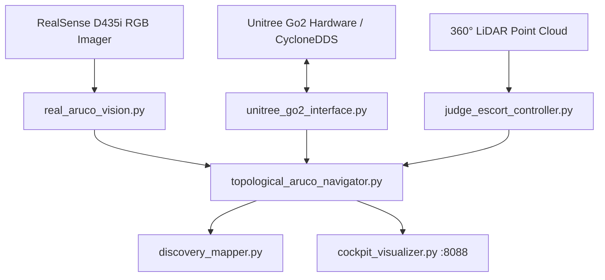

# Project Cloud: Autonomous Quadruped Docent & Makerspace Steward
### High-Level Architecture, Perception Stack, Poster Assets & Deployment Runbook
**Target Event**: DPSI EXPO '26 • **Robot Platform**: Unitree Go2 Pro Quadruped

---

## 1. Executive Summary

**Project Cloud** transforms the Unitree Go2 quadruped into an autonomous docent, crowd-pacing guide, and makerspace steward. Moving through exhibition aisles and corridor pathways, Cloud escorts VIP judges and audience groups, maintaining dynamic companion pacing with a $360^\circ$ 4D LiDAR perimeter, performing interactive docent presentations at exhibition stalls with eye-contact pitch articulation, and navigating using dual-family fiducial visual servoing (**ArUco** & **AprilTag**).

---

## 2. Core Architecture: `unitree_direct_sdk`

The primary deployment architecture runs directly on native Python over high-speed UDP sockets and CycloneDDS (`192.168.123.161:8082`), eliminating ROS 2 and simulator latency for field deployment:

### Key Modules:
- **`unitree_go2_interface.py`**: Direct Python interface to Go2 Sport Client (`Move`, `StandUp`, `Euler` body pitch, `Damp`). Features zero-clipping kinematic emulation for offline verification.
- **`real_aruco_vision.py`**: Multi-family visual perception supporting **ArUco (`DICT_4X4_250`)** and **AprilTag (`DICT_APRILTAG_36h11`)** via `cv2.SOLVEPNP_IPPE_SQUARE`. Factory-calibrated with exact intrinsics ($f_x = f_y = 1642.26\,\text{px}, c_x = 999.63, c_y = 490.62$).
- **`judge_escort_controller.py`**: Companion pacing engine using 360° LiDAR flank clustering ($d_{\text{flank}} = 0.95\,\text{m}$), anti-jerk acceleration limiting ($a_{\text{accel}} \le 0.5\,\text{m/s}^2, a_{\text{decel}} \le 0.8\,\text{m/s}^2$), corridor centering, and $0.60\,\text{m}$ emergency stop.
- **`topological_aruco_navigator.py`**: Hop-by-hop Dijkstra pathing along floor markers (`IDs 100..104`), visual standoff servoing ($0.95\,\text{m}$), 5-step docent pitch sequence ($+8.0^\circ$ eye contact), and $0.65\,\text{m}$ table clearance aisle re-entry.
- **`cockpit_visualizer.py`**: Real-time multi-threaded Web Cockpit at `http://localhost:8088` streaming 30 FPS MJPEG video, telemetry gauges, interactive D-pad controls, and overhead minimap.
- **`Day1_Testes/post_diagnostics.py`**: 7-stage interactive voice-guided Power-On Self-Test (POST) checking Audio, Go2 Telemetry, Actuation, LiDAR Safety Bubble, Optical ArUco & AprilTag tracking.

---

## 3. Optical Calibration & AprilTag Verification

- **Camera**: Intel RealSense D435i RGB Optical Sensor (OmniVision OV2740)
- **Resolution**: $1920 \times 1080$ Full HD (60 Hz / 30 Hz)
- **Calibrated Intrinsic Matrix ($K$)**:
  $$\begin{bmatrix} 1642.26 & 0 & 999.63 \\ 0 & 1642.26 & 490.62 \\ 0 & 0 & 1 \end{bmatrix}$$
- **Reprojection RMSE**: $1.87\,\text{pixels}$ across all 6 coplanar targets (`IDs 10, 11, 12, 13, 14, 15`).
- **PnP Solver**: `cv2.SOLVEPNP_IPPE_SQUARE` eliminates grazing angle pose-flip ambiguity.

---

## 4. Exhibition Poster Suite & Visual Graphics

Four cinematic, Apple-styled exhibition posters engineered for the pavilion display:
1. **Poster 1: Dual Minds (`poster-1-dual-minds.jpg`)**: Edge AI architecture separating high-level docent logic from low-level gait control.
2. **Poster 2: Perception (`poster-2-perception.jpg`)**: Sensor fusion diagram covering 360° 4D LiDAR, RealSense RGB, and floor ArUco/AprilTag tracking.
3. **Poster 3: Locomotion (`poster-3-locomotion.jpg`)**: Omnidirectional dynamic trot, stair traversal, and eye-contact body pitch articulation.
4. **Poster 4: Ready (`poster-4-ready.jpg`)**: Full product showcase with hardware specifications, autonomy metrics, and battery endurance.

---

## 5. Google Drive Visual Resources Archive

All photos provided during development, poster assets, transparent cutouts, printable markers, and presentation slides are preserved and uploaded to Google Drive:

- **Google Drive Root Folder**: `Project_Cloud_Visual_Resources_and_Posters`
  - **Folder ID**: `1IS433N9qY4ObVG8k1niNSdSmNC7YScMq`
- **Master Archive**: `Project_Cloud_All_Visual_Resources.zip` (42.6 MB, ID: `17wDxxVh0COBu6FxxFy4XKhuxtgOE2JID`)
- **Organized Subdirectories**:
  - `User_Uploaded_Photos_62_Items` (ID: `1qYu4_Ox5VBFO7Fvr5Xd9Dw41FqjyLHHv`)
  - `Posters_and_Production_Graphics` (ID: `16BpckSApF587mAUmGhS0fNgiC5MaJsaO`)
  - `Printable_ArUco_and_AprilTag_A4_Sheets` (ID: `1GwWMRl04hKxU5VlZRg_L2_asId2doBfi`)
  - `Keynote_Presentation_Slides` (ID: `1_yM29BhKIjAxFVCcPcrYhkiD5Aq7sYOQ`)

---

## 6. Exhibition Day Runbook Commands

| Task | Execution Command |
| :--- | :--- |
| **1. Power-On Self-Test (POST)** | `./.venv_realsense/bin/python Day1_Testes/post_diagnostics.py --camera 0 --apriltag` |
| **2. Milestone 1: Teach & Map** | `./.venv_realsense/bin/python unitree_direct_sdk/main.py --milestone 1 --apriltag --camera 0 --serve --port 8088` |
| **3. Milestone 2: Docent Presentation** | `./.venv_realsense/bin/python unitree_direct_sdk/main.py --milestone 2 --apriltag --camera 0 --serve --port 8088` |
| **4. Milestone 3: Judge Escort Pacing** | `./.venv_realsense/bin/python unitree_direct_sdk/main.py --milestone 3 --apriltag --camera 0 --serve --port 8088` |
| **5. Milestone 4: Full Autonomous Tour** | `./.venv_realsense/bin/python unitree_direct_sdk/main.py --milestone 4 --apriltag --camera 0 --serve --port 8088` |
| **Physical Hardware Mode** | Add `--real` to any command above when connected to Go2 AP/Ethernet (`192.168.123.161`) |
| **Standard ArUco Mode** | Omit `--apriltag` flag from any command above |
